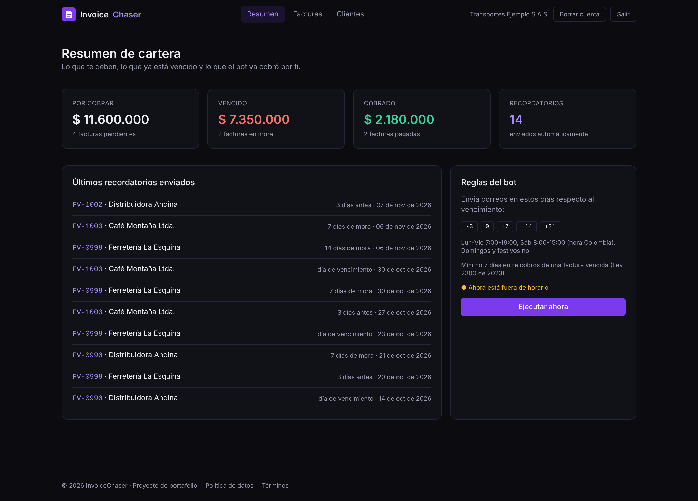
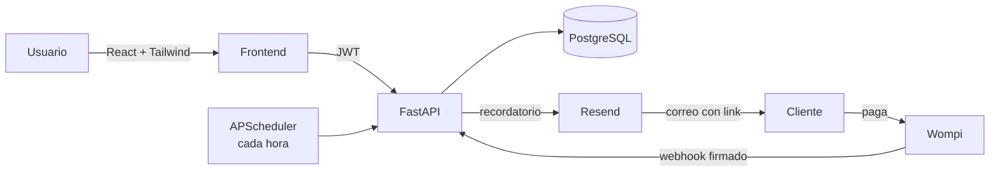
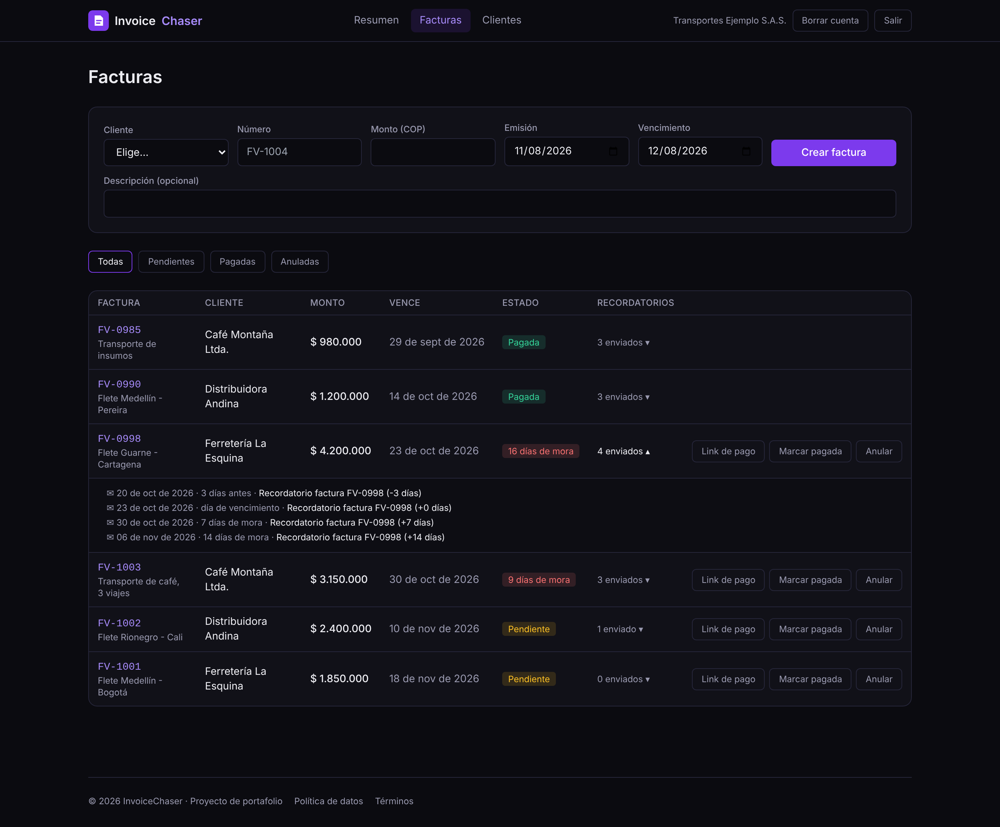
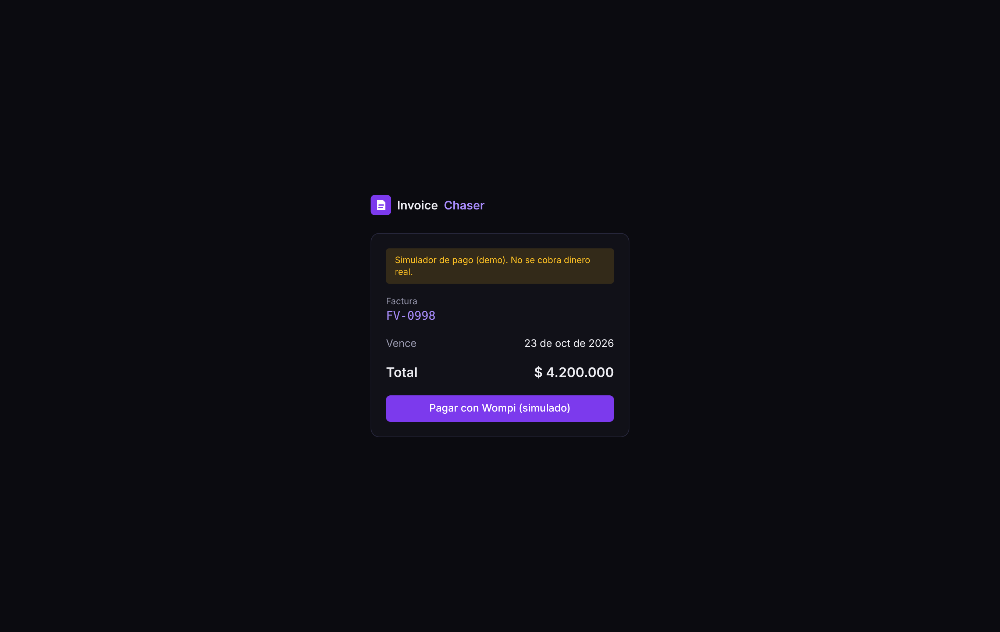
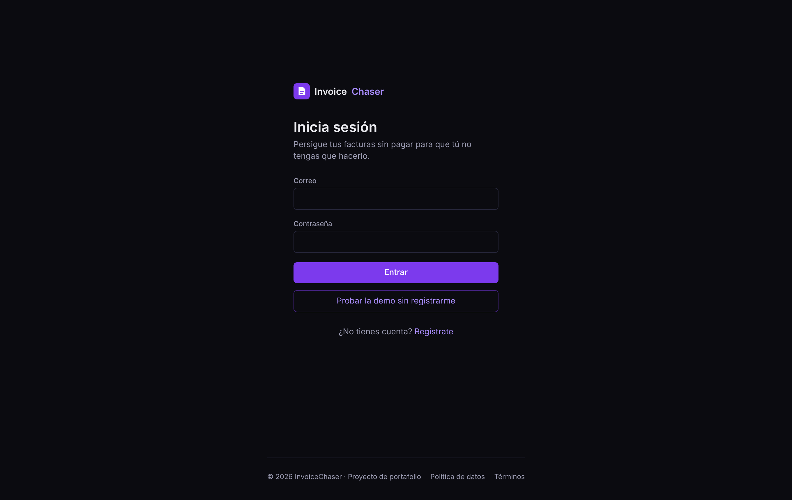
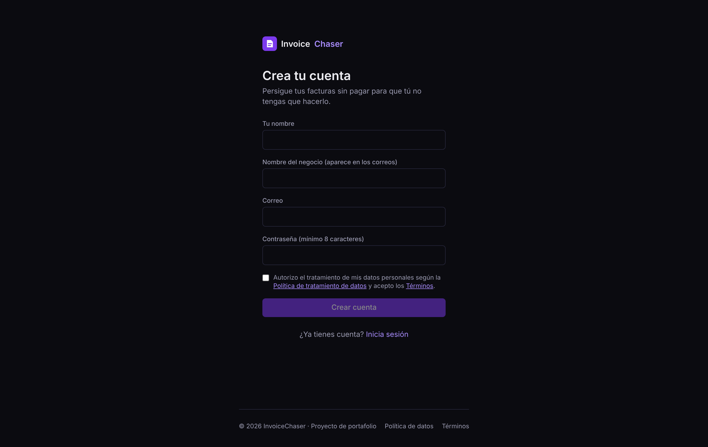

# InvoiceChaser

> Persigue tus facturas sin pagar para que tú no tengas que hacerlo.

InvoiceChaser es un micro-SaaS de cobranza automática para pequeños negocios en Colombia. Registras clientes y facturas, y un bot envía recordatorios por correo en el momento justo, con un link de pago Wompi. Cuando el cliente paga, el webhook marca la factura como pagada y los recordatorios se detienen solos.



**[Probar la demo en vivo](https://invoicechaser-jachi.netlify.app)**: pulsa "Probar la demo sin registrarme". El backend está en el plan gratis de Render, así que la primera carga puede tardar unos 50 segundos mientras el servidor despierta. Los datos de la demo se reinician cada vez que el servidor se reinicia.

## Qué hace

- **Recordatorios automáticos** 3 días antes, el día del vencimiento, y a los 7, 14 y 21 días de mora (configurable). El tono pasa de amable a firme.
- **Link de pago Wompi** en cada correo, firmado con la firma de integridad SHA-256.
- **Webhook de Wompi** con verificación de checksum: un evento sin firma válida o con monto distinto se rechaza. Es idempotente.
- **Horario de cobro respetuoso**, inspirado en la Ley 2300 de 2023 ("Dejen de fregar"): lunes a viernes de 7:00 a 19:00, sábados de 8:00 a 15:00, nunca domingos ni festivos colombianos, y mínimo 7 días entre cobros de una factura vencida.
- **Panel** con lo que te deben, lo vencido, lo cobrado y el historial de recordatorios.
- **Cumplimiento de la Ley 1581 de 2012**: autorización explícita al registrarse (checkbox sin marcar), evidencia de la versión aceptada, política de datos publicada y borrado total de la cuenta.
- **Modo demo**: usuario de prueba con datos ficticios y un simulador de pagos que pasa por el mismo webhook firmado que usaría Wompi real.

## Arquitectura



Cada petición sigue el mismo camino: **ruta → autenticación (JWT) → validación (Pydantic) → lógica → base de datos**. Cada consulta filtra por el dueño, así que un usuario nunca ve datos de otro (está cubierto por tests).

| Capa | Tecnología |
|---|---|
| Backend | Python 3.13, FastAPI, SQLModel |
| Base de datos | PostgreSQL (SQLite en desarrollo y tests) |
| Tareas programadas | APScheduler + `holidays` (festivos de Colombia) |
| Correo | Resend |
| Pagos | Wompi (sandbox) |
| Frontend | React 19, Vite, Tailwind CSS, React Router |
| Seguridad | bcrypt, JWT, rate limiting (slowapi), CORS con lista blanca, security headers |
| Calidad | pytest (21 tests), GitHub Actions |
| Despliegue | Docker, docker-compose |

## Capturas

| Facturas e historial de recordatorios | Pago (simulador Wompi) |
|---|---|
|  |  |

| Inicio de sesión | Registro con autorización Ley 1581 |
|---|---|
|  |  |

## Correr en local

**Backend**

```bash
cd backend
python -m venv .venv
.venv\Scripts\activate          # Windows  (Linux/Mac: source .venv/bin/activate)
pip install -r requirements.txt
copy .env.example .env          # Linux/Mac: cp .env.example .env
uvicorn app.main:app --reload
```

API en http://localhost:8000 y documentación interactiva en http://localhost:8000/docs.

**Frontend**

```bash
cd frontend
npm install
npm run dev
```

Abre http://localhost:5173 y pulsa **"Probar la demo sin registrarme"** (usuario `demo@invoicechaser.dev` / `demo12345`).

**Con Docker (PostgreSQL incluido)**

```bash
cp backend/.env.example backend/.env
docker compose up --build
```

**Tests**

```bash
cd backend
python -m pytest -q
```

## Configuración

Todo se configura por variables de entorno (`backend/.env.example`). Sin llaves de Resend los correos se imprimen en consola, y sin llaves de Wompi se usa el simulador de pagos, así que el proyecto corre completo sin cuentas externas.

| Variable | Para qué |
|---|---|
| `JWT_SECRET` | Firma de los tokens. Obligatoria en producción. |
| `CORS_ORIGINS` | Dominios permitidos, separados por coma. Nunca `*`. |
| `RESEND_API_KEY` | Envío real de correos. |
| `WOMPI_PUBLIC_KEY`, `WOMPI_INTEGRITY_SECRET`, `WOMPI_EVENTS_SECRET` | Pagos reales (sandbox o producción). |
| `REMINDER_OFFSETS` | Días de los recordatorios respecto al vencimiento. |
| `MIN_DAYS_BETWEEN_OVERDUE` | Mínimo de días entre cobros de una factura vencida. |

## Endpoints principales

| Método | Ruta | Descripción |
|---|---|---|
| POST | `/auth/register` | Registro (exige aceptar la política de datos) |
| POST | `/auth/login` | Devuelve un JWT |
| DELETE | `/auth/me` | Borra la cuenta y todos sus datos |
| GET/POST | `/clients` | Clientes del usuario |
| GET/POST | `/invoices` | Facturas (filtro por estado) |
| POST | `/invoices/{id}/mark-paid` | Pago recibido por fuera de la pasarela |
| GET | `/dashboard` | Totales y últimos recordatorios |
| POST | `/reminders/run` | Ejecuta el motor de recordatorios ya mismo |
| POST | `/webhooks/wompi` | Eventos de Wompi (firma verificada) |

## Decisiones de diseño

- **Solo el recordatorio más reciente**: si el servidor estuvo apagado una semana, no le llegan al cliente cinco correos de golpe.
- **Un recordatorio fallido no se registra**, así que se reintenta en la siguiente corrida. Una restricción única en la base de datos impide duplicados.
- **Montos en pesos enteros** (COP no usa decimales en la práctica) y conversión a centavos solo al hablar con Wompi.
- **Sin Stripe**: no abre cuentas a comerciantes colombianos, así que se usa Wompi, que además acepta Nequi y PSE.

## Aviso

Proyecto de portafolio. Los textos legales son plantillas de ejemplo y no constituyen asesoría legal. Todos los datos de la demo son ficticios.

---

Hecho por [Juan Sebastián López Valencia](https://github.com/jsLopez1104) · Ingeniería de Sistemas, Universidad Católica de Oriente.
